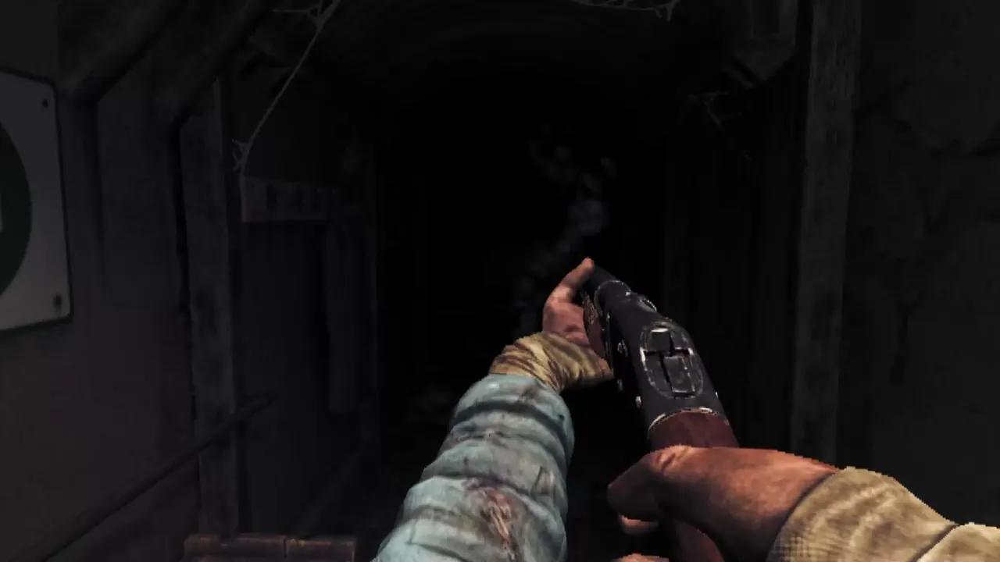
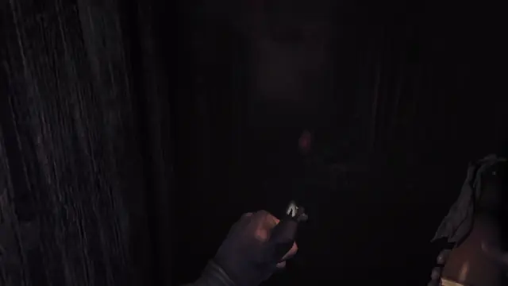
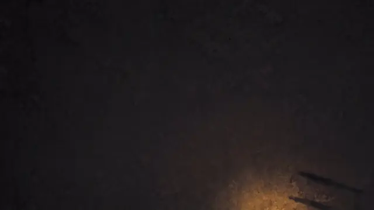

<div align="center">

# BunkerVR

**Amnesia: The Bunker Unofficial VR Port.**

<a href="https://github.com/EdittheWall/BunkerVR/releases/latest"></a>
<a href="#where-its-at"></a>
<a href="https://www.youtube.com/@EditTheWallll"></a>



</div>

> [!WARNING]
> **BunkerVR is an early version and still in active development.** It is completely playable from start to finish, but there is a chance you will run into bugs and glitches. To report any bugs: see [Reporting a bug](#reporting-a-bug).

BunkerVR is a free, unofficial VR port of [Amnesia: The Bunker](https://store.steampowered.com/app/1944430/). All of
the original game's mechanics are built from the ground up to work well in VR.

You have a full set of arms, and everything is done by hand. You reload the revolver one round at a time, rack the
shotgun, light molotovs with your lighter, crank bolts loose with the wrench and climb ladders hand over hand. You
crouch and lean for real, and the Beast sees you at your real height.

<p align="center">
  
  
</p>

## What you need

- **Amnesia: The Bunker on Steam**, up to date. The mod is made for the current Steam version.
- **Windows 10 or 11**, 64-bit.
- **A PC VR headset with motion controllers.**

  | Headset | Status |
  |---|---|
  | Oculus Rift CV1 | Works well |
  | Meta Quest 3 / 3S | Works well |
  | PlayStation VR2 | Works well |
  | Pico 4 | Works well |
  | Valve Index | Being tested |
  | Pimax | Not tested yet |

  Other OpenXR headsets should work too. If yours doesn't, please
  [open an issue](https://github.com/EdittheWall/BunkerVR/issues/new/choose).
- **A PC that runs the game comfortably** with headroom to spare: VR draws every frame twice.

## Installing

1. Download the **BunkerVR Setup** from the [latest release](https://github.com/EdittheWall/BunkerVR/releases/latest).
2. Run the Setup and click **Install**.
3. Start the game normally on Steam.

Windows may show "Windows protected your PC". Click **More info**, then **Run anyway** and continue.

To update BunkerVR, run the newest BunkerVR Setup. To uninstall, remove BunkerVR in Windows' **Installed apps**.

## Playing

| | Left controller | Right controller |
|---|---|---|
| **Thumbstick** | Move. Click: sprint | Turn. Up: jump or stand up. Down: crouch. Click: flashlight |
| **Grip** | Grab | Grab |
| **Trigger** | Use held item | Fire or use held item |
| **Buttons** | X: put away. Y: menu (hold: recenter) | A: weapon. B: inventory |

Everything else is done with your hands, and small hints show you how the first few times. Full controls are in
[docs/controls.md](docs/controls.md), and every VR option is in the game's menu under **Options > VR**
([docs/settings.md](docs/settings.md)).

## What's in it

**Body**
- Full arms with IK that follow your controllers
- Finger poses from your controllers: open, point, fist, thumbs up
- Physical crouching, leaning and room-scale movement
- Real-height stealth: enemies see where your head really is, and fast steps make noise
- Body holsters for the revolver, ammo, shotgun, flashlight and one extra item
- Hand-over-hand ladder climbing

**Weapons**
- Revolver with manual reloading: flick the cylinder open, shake out the casings, load each round by hand
- Two-handed shotgun with a pump you rack after every shot
- Grenades with a pin you pull with your other hand
- Physics-based throwing for molotovs, flares, bottles and anything else you can pick up

**Interactions**
- Doors, drawers, levers, wheels and hatches you grab and move
- Keys, fuses and combination locks used by hand
- A wrench you crank and bolt cutters you squeeze with both hands
- Fuel you pour, a lighter you flick, a watch you wind and a gas mask you pull over your face
- Healing by wrapping a bandage around your forearm

**Comfort**
- Smooth and snap turning
- Comfort vignette and reduced or no head bob
- Seated and standing modes with height calibration
- Knockdowns and deaths in first person, on a screen or behind a vignette
- Cutscenes on a virtual cinema screen
- Adjustable world scale, grab reach, throw assist and haptics
- A steady spectator view for streaming and recording

## Where it's at

Still being worked on:

- Performance in the heaviest areas
- A few scenes that still play like the flat game
- Translations of the mod's own texts
- Left-handed mode

See the [changelog](CHANGELOG.md) for what each version changed, and [YouTube](https://www.youtube.com/@EditTheWallll)
for progress videos.

## Reporting a bug

1. **Mark the moment** when something goes wrong: hold the left thumbstick in and click the right thumbstick. The mod
   notes the time and saves pictures of both eyes, which makes the problem much easier to find.
2. After playing, close the game and double-click **BunkerVR Logs** on your desktop. It puts one zip file on your
   desktop with everything needed: the mod's and the game's logs, your marks, your settings and your PC's VR setup.
   It contains no personal files.
3. [Open an issue](https://github.com/EdittheWall/BunkerVR/issues/new/choose), describe what happened, and attach
   the zip.

## Building from source

You need Visual Studio 2022 with the C++ desktop workload (it includes CMake and Ninja). From a
**x64 Native Tools Command Prompt**:

```bat
cmake --preset player
cmake --build --preset player
```

CMake downloads the Khronos OpenXR SDK on the first run. The build gives `version.dll` (the mod) and
`BunkerVR_watch.exe` (a small helper that releases any key or button the mod holds if the game closes unexpectedly).

To install your build into the game, run `tools\install_dev.ps1 -Game "<the game's folder>"`. It copies the two
files, copies the mod's own game files from `game\`, and applies the patches in `patches\` to the game's scripts.
[docs/building.md](docs/building.md) covers the details, including how the patches work and how Setup is built.

## How it works

Amnesia: The Bunker runs on Frictional Games' HPL engine, which has no VR support. BunkerVR loads into the game as
`version.dll`, drives the headset through OpenXR, renders each eye from the game's camera and lays the game's
interface out in the room. Most of the gameplay lives in the game's own AngelScript scripts, so the mod extends
those: the body, the hands and every item's behavior in VR are script code, patched into the game's files.
[docs/how-it-works.md](docs/how-it-works.md) goes into more depth.

The repository contains no files from the game. The `patches\` folder holds only the mod's own lines and
instructions on where they go; Setup applies them to the files already on your PC, and only if those files are the
exact version the patches were made for.

## Credits

BunkerVR is made by **Mina Studio**. Every mechanic was designed, played and tuned in the headset, round after
round, until it felt right.

The code was written with **[Claude](https://www.anthropic.com/claude)** by Anthropic, using Claude Code.

BunkerVR is built on the [Khronos OpenXR SDK](https://github.com/KhronosGroup/OpenXR-SDK) (Apache 2.0),
[MinHook](https://github.com/TsudaKageyu/minhook) (BSD 2-Clause), [Dear ImGui](https://github.com/ocornut/imgui)
(MIT) and the [DejaVu](https://dejavu-fonts.github.io/) fonts. Their licenses are in [docs/licenses](docs/licenses).

## Disclaimer

BunkerVR is a free fan project. It is not affiliated with, endorsed by or sponsored by Frictional Games.
Amnesia: The Bunker and everything in it belong to Frictional Games. You need your own copy of the game, and the mod
is not for sale.

## License

BunkerVR's own code is released under the [MIT License](LICENSE). The third-party libraries keep their own licenses.
The license does not cover Amnesia: The Bunker or any of Frictional Games' content.
